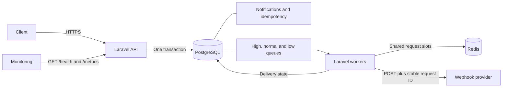

# Architecture

## Atomic acceptance

The API writes the notification and its database job on the same Laravel connection in one transaction. The database queue is the durable handoff to workers. This removes the two-write failure window of a separate broker. Laravel uses row locking with `SKIP LOCKED` for PostgreSQL job reservation. Any future move to a separate broker would require a transactional outbox and a relay.

Idempotency records use a unique hash of endpoint and key. Concurrent identical requests converge on the same resource. Conflicting payloads return 409. The optional key belongs to the caller's logical intent. Repeating a request with a new key creates a new notification.

## State transitions

- `pending` and `retrying` can transition to `processing` or `cancelled`.
- `processing` can transition to `accepted`, `retrying`, `failed`, or `uncertain`.
- A manual retry moves `failed` to `pending` and inserts a job atomically. The retry generation rejects stale requests and prevents jobs from earlier cycles from changing the new cycle.
- `accepted` records provider acceptance. Twilio SMS stores carrier delivery receipts separately in `delivery_status`. Signed callbacks match the account, notification ID, retry generation, attempt and known Twilio message SID. A callback can arrive before the send response and settle acceptance without being overwritten by the worker.
- `uncertain` records a send whose outcome could not be established. Reconciliation requires provider evidence or an operator decision.

Workers claim with a short row-locking transaction and release the lock before network IO. A worker timeout is shorter than the queue reservation visibility timeout. A recovered stale claim becomes uncertain. A stable external idempotency header aids reconciliation and supports a provider that honors it.

## Scale and visibility

Independent worker processes and indexed PostgreSQL queries handle burst backlogs. Every provider call reserves one of 100 Redis slots for its channel before sending. Redis retains the slot until one second after a known response. The reservation still counts when the worker is preparing the request or waiting for the provider, so a delayed request cannot arrive after its slot has already been reused. Unknown results and interrupted workers retain their slots until a 60-second lease expires. This lease assumes the provider's reception delay stays within it. The limiter relies on shared Redis state across workers.

Dedicated normal and low workers from the optional Compose profile reserve worker capacity when high-priority traffic saturates the shared pool. Each channel shares its rate budget across all priorities. Stop old workers before starting workers with a new rate limiter policy so incompatible Redis slot formats never run together.

The API reads current state directly. Metrics expose queue depth by priority and aggregate recent delivery outcomes and latency. Logs carry correlation and notification IDs. For a larger installation, benchmark the actual provider latency, partition or archive terminal history, and export telemetry without scanning the transactional store. Default deployment targets a local assessment environment.
